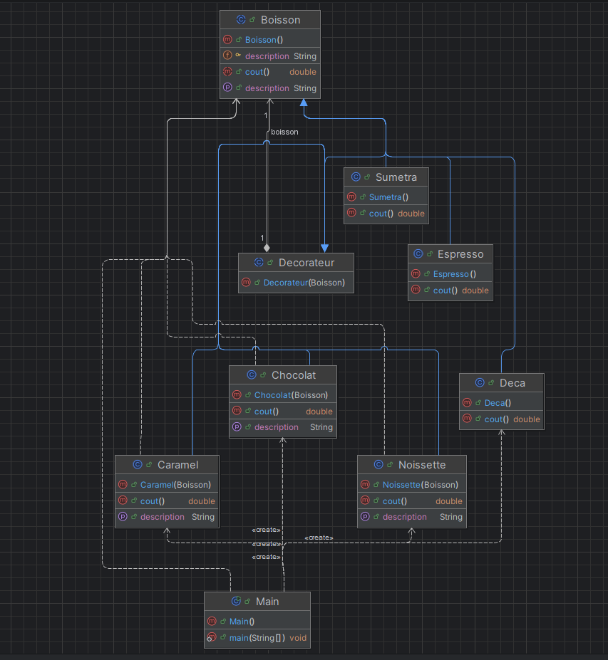

# Design Pattern Décorateur en Java

Ce projet est une implémentation simple et pédagogique du **Design Pattern Décorateur** (Decorator) en Java. Il s'inscrit dans le cadre de l'Activité Pratique N° 2 encadrée par M. Mohamed Youssfi. Il illustre comment ajouter dynamiquement des responsabilités ou des comportements à un objet en l'enveloppant dans des objets décorateurs compatibles.

## Architecture du Projet

Le projet suit une structure orientée objet propre avec les composants suivants :
- **`Boisson`** (Classe Abstraite) : Représente le composant de base, définissant la méthode `cout()` et la propriété `description`.
- **`Sumatra`**, **`Espresso`**, **`Deca`** (Classes Concrètes) : Représentent les boissons de base concrètes héritant de `Boisson`.
- **`Decorateur`** (Classe Abstraite) : La classe décoratrice qui hérite de `Boisson` et contient une référence vers un objet `Boisson` (composition).
- **`Chocolat`**, **`Caramel`**, **`Noisette`** (Classes Concrètes) : Les décorateurs concrets qui viennent enrichir le coût et la description de la boisson enveloppée.
- **`Main`** : La classe principale (`EntryPoint`) permettant de tester l'assemblage dynamique des boissons et des condiments.

## Diagramme de Classes

Le diagramme ci-dessous illustre la structure des classes et des relations du projet :



## Technologies Utilisées
- **Java** (JDK 21)
- **Maven** (Gestion de projet et compilation)
- **IntelliJ IDEA** (Environnement de développement)

## Exemple d'utilisation

```java
// Création d'une boisson de base (Espresso)
Boisson boisson = new Espresso();
System.out.println(boisson.getDescription() + " " + boisson.getCout() + " €");

// Ajout d'un décorateur (Chocolat)
boisson = new Chocolat(boisson);

// Ajout d'un autre décorateur (Caramel)
boisson = new Caramel(boisson);

System.out.println(boisson.getDescription() + " " + boisson.getCout() + " €");
